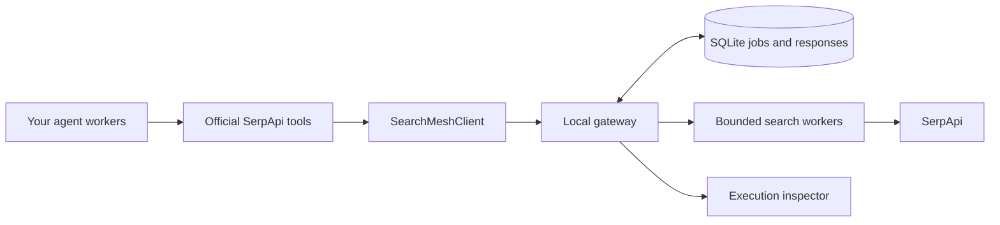

# SearchMesh

**Shared, recoverable, inspectable SerpApi retrieval for AI agent teams.**

SearchMesh is an MIT-licensed Python extension for developers building multi-agent applications with [serpapi-search-tools](https://serpapi.github.io/serpapi-search-tools-python/). It plugs into the library's existing `client=` interface and coordinates searches through a persistent local gateway.

If two workers need the same search, they can share a compatible in-flight retrieval or reuse a sufficiently fresh response. Each caller keeps its own deadline and freshness policy. If a search worker loses ownership, the gateway can recover the retrieval job and prevent a stale worker from overwriting the recovered result. Requests, attempts and evidence remain inspectable.

**The target user is an agent developer.** The included application demonstrates the extension through a practical task: a prospective café owner researches competitors, published prices and customer complaints from one question. Groq plans the research; SerpApi supplies search data; SearchMesh coordinates retrieval underneath.

Track: **Open-Source Integrations** · Python 3.11–3.13 · Local runtime · MIT

## What did we build?

| Layer | Responsibility |
| --- | --- |
| Existing SerpApi service | Retrieves search-engine results. |
| Existing serpapi-search-tools | Tool schemas, validation, SDK adapters and result formatting. |
| **Our SearchMeshClient and gateway** | Compatible request sharing, freshness, attempt budgets, persisted jobs, ownership recovery and response provenance. |
| Included research application | Groq plans 2–4 tasks, optionally uses shared discovery, refines dependent queries and synthesizes returned snippets. |

This is an independent custom-client extension. It does not modify SerpApi's package and is not an upstream-merged feature, a new search engine or an MCP server.



## Run the application

Clone this repository and create an environment:

```sh
git clone https://github.com/varmaleena/SearchMesh.git
cd SearchMesh
```

```sh
python -m venv .venv
```

Activate with `.venv\Scripts\activate` on Windows Command Prompt, `.\.venv\Scripts\Activate.ps1` on PowerShell, or `source .venv/bin/activate` on macOS/Linux.

```sh
python -m pip install -e ".[test]"
searchmesh serve --mode fixture --port 8000
```

Open [the fixture workspace](http://127.0.0.1:8000/#workspace). No keys are required. Fixture planning and search content are explicitly synthetic.

For **live research**, copy `.env.example` to `.env` and configure:

```dotenv
SERPAPI_API_KEY=your_serpapi_key
GROQ_API_KEY=your_groq_key
SEARCHMESH_GROQ_MODEL=openai/gpt-oss-20b
```

Use your own [SerpApi account](https://serpapi.com/users/sign_up) and [Groq Console](https://console.groq.com/keys). Never commit credentials. Select a currently available Groq model if necessary.

```sh
python tools/start-live.py
```

The launcher reads recognized `.env` settings and opens [the live app](http://127.0.0.1:8001/#workspace). The CLI itself reads environment variables, not `.env`.

Try one question:

> I'm opening a café for remote workers in HSR Layout, Bengaluru. Find competitors, compare published coffee prices, and examine reviews for complaints about Wi-Fi, sockets, seating, noise and service. Suggest three opportunities, citing sources and marking missing evidence.

Groq chooses tasks. Shared discovery is optional and must have a genuine dependency. Workers that need it read returned snippets and refine their queries before searching. No duplicates are inserted to inflate savings.

## Add SearchMesh to your existing library integration

Keep your models, agent SDK and official tools. **The change is `client=mesh`.** This uses SerpApi's documented [custom-client extension point](https://serpapi.github.io/serpapi-search-tools-python/user-guide/configuration.html#custom-clients). Do not edit site-packages.

### 1. Install the extension

From this source checkout, install in your application's environment:

```sh
python -m pip install -e .
```

Or build and install a local wheel:

```sh
python -m pip install build
python -m build --wheel
python -m pip install dist/searchmesh_runtime-0.1.0-py3-none-any.whl
```

Distribution: `searchmesh-runtime`. Python import: `searchmesh`. The official `serpapi-search-tools` package is a dependency. No PyPI publication is claimed.

### 2. Start the gateway and configure its token

Use `python tools/start-live.py` for the included application. For adapter-only usage, Groq is unnecessary: set `SERPAPI_API_KEY` in the gateway environment and run `searchmesh serve --mode live --port 8001`.

The gateway prints a **local agent access token**. Set `SEARCHMESH_GATEWAY_TOKEN` to that token in the shell running your agent code. This is separate from the SerpApi key. Restarting with a generated token requires updating agent clients. You may instead configure a stable token in the gateway environment before startup.

### 3. Inject the client

```python
import os
from serpapi_search_tools import SearchResultFormat, web_search
from searchmesh.client import SearchMeshClient

mesh = SearchMeshClient(
    gateway_url="http://127.0.0.1:8001",
    token=os.environ["SEARCHMESH_GATEWAY_TOKEN"],
    agent_id="competitor-researcher",
    max_age_seconds=300,
    deadline_seconds=120,
)
run = mesh.create_run("Café market research", budget_limit=20)

# Before: search = web_search(provider="function")
search = web_search(provider="function", client=mesh, response_format=SearchResultFormat.JSON)
print(search(query="specialty coffee shops HSR Layout Bengaluru"))
```

Use `response_format=SearchResultFormat.JSON`: this adapter returns dictionaries. The upstream Markdown transport expects a string and is outside this adapter contract. The tool still accepts `query=` and formats JSON results normally. SearchMesh implements the synchronous `search(params) -> dict` contract. The SerpApi key stays on the gateway.

### 4. Connect other workers

Each worker gets a separate client and agent identity, sharing the run ID:

```python
other_worker = SearchMeshClient(
    gateway_url="http://127.0.0.1:8001",
    token=os.environ["SEARCHMESH_GATEWAY_TOKEN"],
    run_id=run["id"],
    agent_id="price-researcher",
    max_age_seconds=300,
    deadline_seconds=120,
)
price_search = web_search(provider="function", client=other_worker, response_format=SearchResultFormat.JSON)
```

Exact compatible parameters and caller policies determine sharing. Different queries remain separate jobs. See [the runnable example](examples/shared_search.py) and [integration guide](docs/integration.md).

### 5. Attach the tool to an agent SDK

Install the SDK you use. Construct the official tool with its provider name and `client=mesh`, for example `web_search(provider="google-adk", client=mesh, response_format=SearchResultFormat.JSON)`, then attach the returned tool through your framework's normal tools API. Models and SDK dependencies remain your choice. Follow the official [SDK examples](https://serpapi.github.io/serpapi-search-tools-python/user-guide/frameworks.html).

Our primary verified contract is the synchronous function provider. An optional [Google ADK example](examples/adk_team.py) uses `.[demo]` dependencies and separate Gemini configuration. The gateway currently accepts `google_light`, `google` and `google_news`. Other upstream engines are rejected. Not every SDK combination has been verified end to end.

## What to inspect in the demo

1. **Live application:** one question, generated plan, worker states, source cards and answer. Nothing is preloaded.
2. **How SearchMesh works:** actual callers, jobs, joins, reuse and response IDs.
3. **Compare direct vs SearchMesh:** replay the actual generated query stages through both tool paths. This makes additional provider requests.
4. **Implementation inspector:** attempts, ownership generations, leases, events and trace export.
5. **Simulate worker failure:** a separate explicit probe demonstrates lease expiry and recovery without altering the original answer.
6. **Run history:** earlier runs appear only when explicitly loaded.

## Engineering and verification

SQLite WAL transactions protect request sharing, attempt reservations and ownership changes. Workers heartbeat leases; increasing generations fence stale writers. Subscriber deadlines and freshness are checked individually. Idempotency keys survive transport retries. Immutable response IDs connect registered findings to their evidence; changed content can flag findings for review.

```sh
python -m pytest tests -q
searchmesh benchmark --mode fixture --iterations 30 --output reports
```

Tests cover the upstream custom-client contract, isolation, exact qualifiers, freshness, budgets, idempotency, deadlines, recovery, evidence changes, automatic planning and paired replay. Browser checks in `tools/` require Playwright and a local browser. See [architecture](docs/architecture.md), [verification](docs/final-verification.md) and [demo script](docs/submission-demo.md). Local API docs are at `/docs`.

## Measurement and deployment limits

- Compatible identical requests can share work; no overlap can correctly mean zero joins and equal provider attempts.
- Paired replay freezes queries and normalizes fresh retrieval. One sequential direct-then-mesh trial does not establish typical latency or billed-credit savings. Retries count as attempts, not confirmed billed credits.
- Retrieval freshness does not establish webpage freshness. Unknown age triggers refresh or explicit failure.
- Recovery is at least once: ambiguous provider work may repeat. Persisted retrieval jobs do not imply full restart recovery of model orchestration.
- Snippets are evidence leads. The app does not independently verify every page, price or review.
- This is a loopback-only runtime. Production accounts, cloud deployment and distributed workers are outside this version.
- The older fixed-input conformance path remains in tests; the primary UI uses one-question model-generated plans.

## Attribution and license

MIT; see [LICENSE](LICENSE). SerpApi and its official tools provide search and tool capabilities. Groq provides model inference. OpenAI Codex assisted development, documentation and verification; Gemini was used in earlier integration testing. SearchMesh is independently developed and is not an official SerpApi product.
